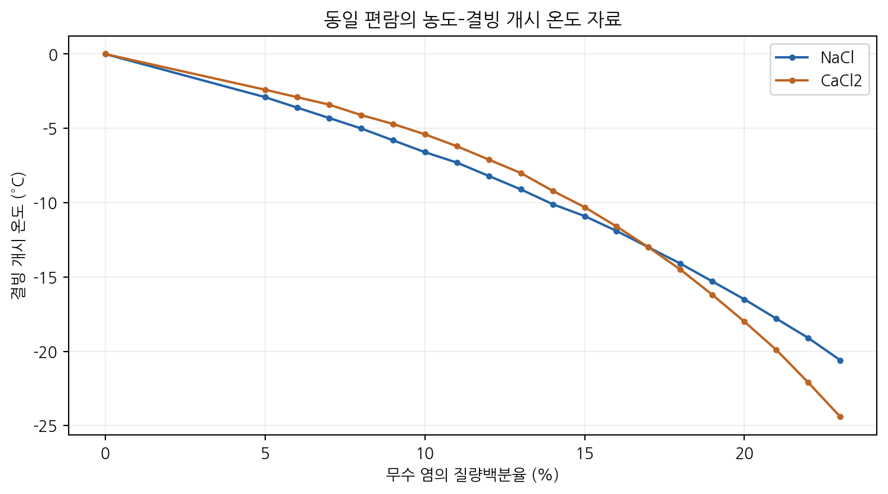
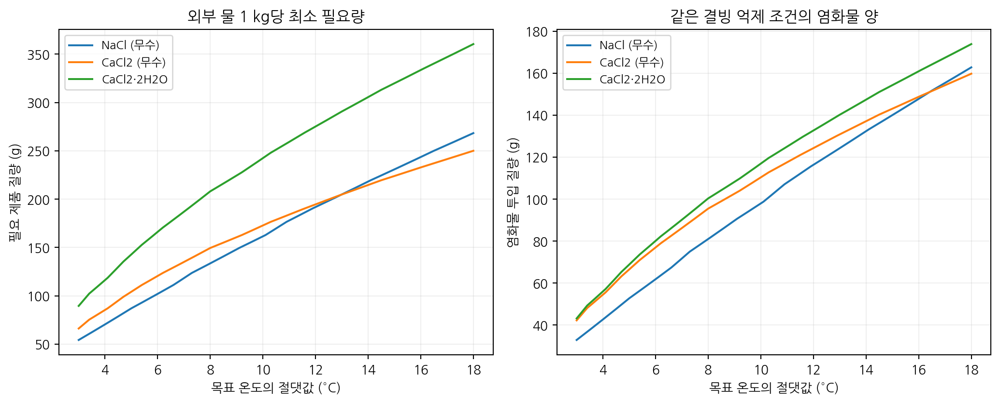
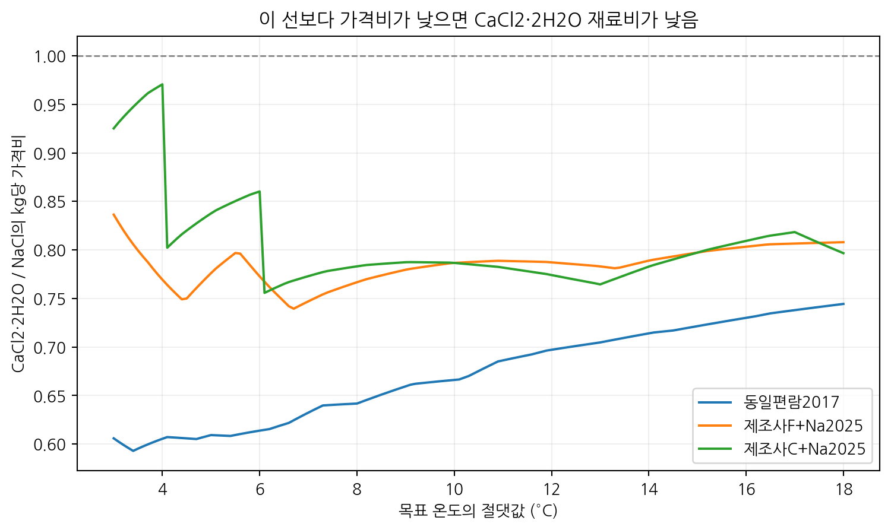
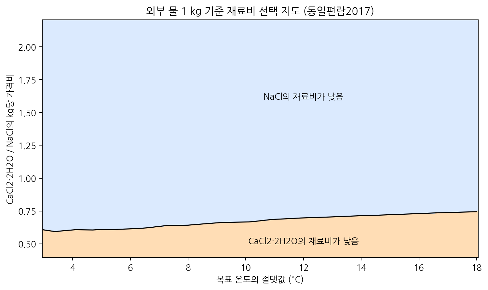
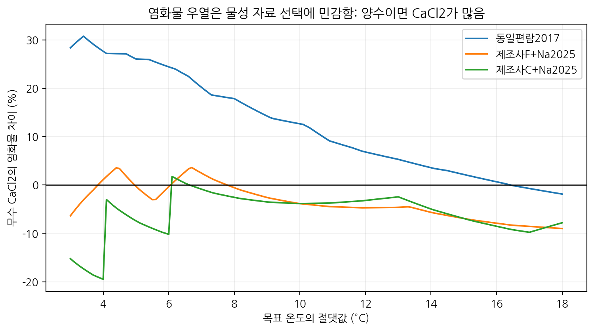
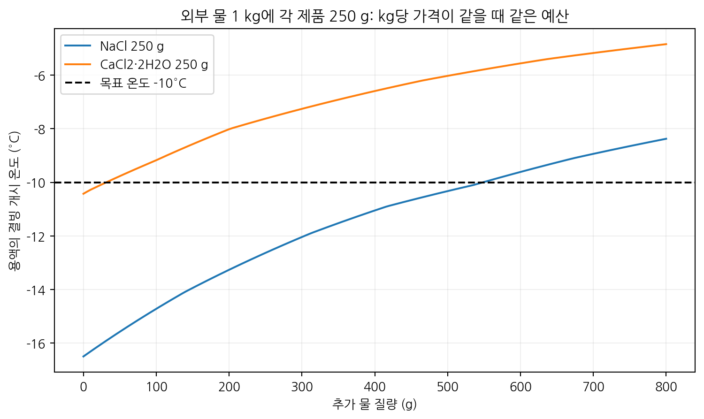
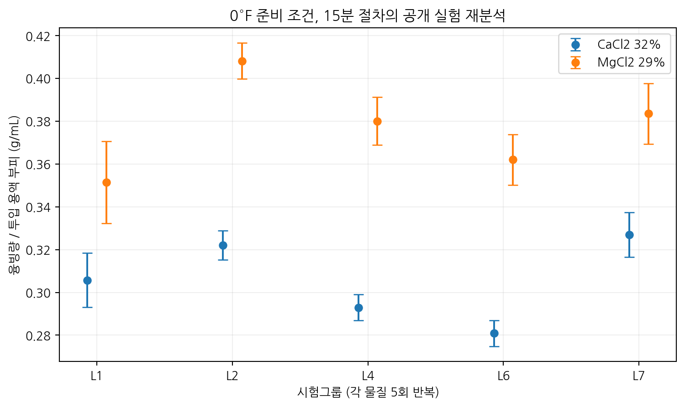

# 염화칼슘을 선택할 조건은 무엇인가?

문헌 물성·제품의 결정수·실제 반복 융빙 데이터를 이용한 제설제 선택 조건 분석

연구 완료일: 2026-10-21 | 연구 방법: 공개 자료 재분석 및 Python 수치 계산

## 초록

본 연구는 같은 결빙 억제 조건에서 제설제의 필요량·재료비·염화물 투입량을 비교했다. 외부 물 1 kg을 기준으로 농도–결빙 개시 온도 표를 보간하고, 무수 염과 수화물의 질량수지를 구분했다. 물성 자료 131행을 정리하고, -3~-18°C의 151개 온도를 세 자료 조건에 적용하여 453개 계산 조건을 분석했다. 이 숫자는 새로 수행한 실험 횟수가 아니다. 같은 제조사 표의 화씨판·섭씨판은 서로 독립적인 실험 자료가 아니다.

기본 자료에서 -10°C의 최소 필요량은 NaCl 161.4 g, 무수 CaCl2 172.7 g, CaCl2·2H2O 242.4 g이었다. 수화물 제품의 kg당 가격이 NaCl의 0.666배 이하여야 재료비가 같거나 낮았다. 제조사 물성표를 적용해도 이 경계는 0.787배였다. 공개 구매 공고의 예산 단가를 적용한 -10°C 시나리오에서 CaCl2 비용은 NaCl의 약 2.10~2.70배였다. 염화물 투입량의 우열은 물성 자료에 따라 바뀌었다.

추가로 공개 반복 관측값 120개를 정리했다. 온도가 호환되는 0°F의 두 액상 용액을 재분석한 결과, 원문 선별 그룹에서 MgCl2 29%의 부피당 융빙량은 CaCl2 32%의 1.233배였다. 연구 결과는 ‘염화칼슘을 항상 선택한다’는 기준보다 제품 조성·온도·가격·목표 성능을 명시하는 기준이 필요함을 보여준다.

## 1. 연구 질문과 탐구의 의의

염화칼슘은 겨울철에 널리 사용되지만, 낮은 공융점 하나만으로 특정 온도에서 필요한 제품 질량이나 비용을 정할 수 없다. 본 연구는 ‘같은 온도에서 액상 유지 경계에 도달하는 최소량’이라는 기능을 정하여 비교했다. 프로그램으로 얻는 결과는 온도별 필요량, 가격비 손익분기점, 희석 한계와 자료 선택에 따른 결론의 변화다.

핵심 질문은 다음과 같다. 같은 결빙 억제 조건에 CaCl2가 실제로 더 적게 필요한가? 결정수가 포함된 제품은 비용 비교를 어떻게 바꾸는가? 비용을 줄이는 선택은 염화물 투입량도 줄이는가? 실제 반복 실험값은 어떤 조건에서 서로 비교할 수 있는가?

교과 연결은 용액의 농도, 어는점 내림, 물질의 상태와 상평형, 질량 보존이다. 교과식의 입자수 개념으로 계산하면 무수 염 1 g의 이상적 총 이온 몰수는 NaCl 약 0.0342 mol, CaCl2 약 0.0270 mol이다. 화학식 한 단위에서 나오는 이온 수만으로 질량당 성능을 판단할 수 없는 이유다. 고농도에서는 이 수치만으로 어는점을 예측하지 않고 문헌 물성을 사용했다.

## 2. 자료 수집과 선별

기본 계산에는 ASHRAE 2017 SI판의 순수 CaCl2와 NaCl 표를 사용했다. 이 표는 같은 편람 안에서 두 물질을 비교할 수 있고, 농도–결빙 개시 온도가 함께 제시되어 있다. 두 물질 모두 공융점보다 묽은 쪽 자료만 사용했다. 분석 온도 -3~-18°C는 확보한 표의 범위 안에 있다.

대안 계산에는 ASHRAE 2025의 NaCl 표와 OxyChem 2026의 CaCl2 표를 사용했다. OxyChem 표는 제조사 제품의 전형적 물성으로, 순수물질 표와 동일한 참값이라고 가정하지 않았다. 화씨 표의 값을 섭씨로 변환한 경우와, 정수 섭씨로 제시된 표를 이용한 경우를 구분했다. 후자는 반올림에 따른 평탄 구간이 있어 역보간 시 최소 농도를 찾도록 했다.

ASHRAE 2025의 CaCl2 표는 다른 상도와 고농도 구간에서 일치하지 않아 기본 계산에 포함하지 않았다. FHWA Appendix B의 -10°C 근삿값도 같은 문서 Appendix A의 표와 차이가 있어 결과를 확정하는 입력으로 사용하지 않았다. 자료 선택 이유와 보류 항목은 outputs/data_audit.json에 남겼다.

가격 예시는 광주시 공고 제2025-2680호, R25BK01063857-000의 재게시 공고문에서 가져왔다. NaCl 85% 이상 338톤의 예산 29,744,000원은 kg당 88원, CaCl2 74% 이상 331톤의 예산 60,076,500원은 kg당 181.5원이다. 부가세 포함 예산 단가이며, 유찰 표시가 있는 공고의 자료다. 실제 낙찰가나 현재 전국 시장가격으로 해석하지 않았다. 원 G2B 파일 직접 다운로드는 503 오류로 확보하지 못했으며, 공고 재게시 텍스트를 참고했다.

실제 융빙 관측값은 CR18-06 보고서 Table A-1의 세 염에 대한 8개 시험그룹 × 5회 반복, 총 120개를 사용했다. 시험그룹에는 기관 차이와 동일 기관 내 작업자 차이가 함께 들어 있다. NaCl의 준비 온도는 15°F이고 CaCl2·MgCl2는 0°F이므로 세 염을 하나의 성능 순위로 비교하지 않았다.

## 3. 계산 방법

모든 질량은 kg, 온도는 °C, 가격은 원/kg으로 통일했다. 목표 온도 T에 대응하는 최소 염 질량분율 w는 출처별 농도–결빙 온도 표의 구간선형 보간으로 구했다. 데이터 밖으로 외삽하지 않았다. 계산 격자 0.1°C는 그림을 생성하기 위한 간격이며 물성표가 0.1°C 정확도라는 뜻이 아니다.

외부 물 질량 W0, 제품 질량 Q, 무수 염 함량 a, 제품에 포함된 물의 함량 h를 사용하면 다음 식이 성립한다. 다른 성분은 비상호작용 불용성 불활성 성분이라는 모델 조건에서만 제외할 수 있다.

    w = aQ / [W0 + (a+h)Q]
    Q = wW0 / [a(1-w)-wh]
    비용 = P Q
    염화물 질량 = aQ fCl

NaCl의 염화물 질량비 fCl은 0.6066, CaCl2는 0.6389다. CaCl2·2H2O에서 무수 염의 질량분율은 0.754908이다. 물의 유입은 결정수도 포함하므로 외부 물이 같은 조건에서 단순히 ‘무수 필요량/순도’만 계산하면 부족해질 수 있다.

두 제품의 비용이 같아지는 가격비는 P_Ca/P_Na = Q_Na/Q_Ca다. 이 값보다 Ca 제품의 가격비가 작으면 Ca 쪽 재료비가 낮다. 염화물 질량은 환경 관련 투입 지표로 사용했으며, 하천 농도·부식량·생태 피해의 종합 점수로 바꾸지 않았다.

## 4. 결과: 온도별 필요량과 가격비 경계

다음 결과는 외부 물 1 kg, ASHRAE 2017 자료를 기준으로 한다. CaCl2·2H2O는 이상적인 순수 이수화물이며, 함량 74%라고 표시된 모든 시판 제품과 동일하다는 뜻은 아니다.

| 온도 | NaCl 무수 | CaCl2 무수 | CaCl2·2H2O | 수화물/NaCl 가격비 경계 |
|---|---:|---:|---:|---:|
| -5°C | 87.0 g | 104.1 g | 142.7 g | 0.609 |
| -10°C | 161.4 g | 172.7 g | 242.4 g | 0.666 |
| -15°C | 230.8 g | 223.9 g | 319.8 g | 0.722 |
| -18°C | 268.3 g | 250.0 g | 360.4 g | 0.744 |

-10°C에서 순수 NaCl과 이수화물의 kg당 가격이 같다면 CaCl2·2H2O 쪽 재료비가 약 1.50배다. 이수화물의 가격이 NaCl보다 약 33.4% 낮아져야 비용이 같아진다. 무수 CaCl2끼리 비교할 때의 경계 0.935와 다르므로 제품 형태를 생략한 가격 비교는 적절하지 않다.

결정수 보정의 영향도 확인했다. -10°C의 무수 CaCl2 필요량 172.7 g을 함량만으로 나누면 228.8 g이지만, 결정수가 외부 물 1 kg에 추가되는 것까지 계산하면 242.4 g이다. 약 5.9%의 차이가 생겼다. 이 차이는 임의로 만든 오차가 아니라 질량 보존에서 나오는 차이다.

제조사 물성표와 2025 NaCl 표로 다시 계산하면 -10°C의 이수화물 가격비 경계는 0.787다. 기본 자료의 0.666와 수치는 다르지만 둘 다 1보다 작다. 분석한 세 자료 조건의 -3~-18°C 계산 격자 전체에서도 이 경계는 1보다 작았다. 따라서 이 연구의 이상적 제품 비교에서는 같은 kg당 가격일 때 NaCl이 평형 결빙 억제 재료비에서 유리하다는 결론이 유지됐다.

## 5. 결과: 공개 구매 공고 예산을 적용한 비용

공고의 규격 하한인 NaCl 85%, CaCl2 74%를 정확한 함량이라고 둔 계산 시나리오를 만들었다. 나머지 성분이 물인 경우와 비상호작용 불용성 성분인 경우를 양 끝으로 계산했다. 실제 제품에 다른 용해성 염이나 첨가제가 있다면 이 범위가 실제 성능을 보장하지 않는다.

단가 비는 181.5/88 = 2.0625다. -10°C, 외부 물 1 kg에 대한 결과는 다음과 같다. 표의 범위는 조성 가정의 범위이며 통계적 신뢰구간이 아니다.

| 물성 자료 조건 | NaCl 비용 | CaCl2 비용 | Ca/Na 비용비 |
|---|---:|---:|---:|
| 같은 편람의 순수물질 표 | 16.71~17.20원 | 42.36~45.10원 | 2.46~2.70배 |
| 제조사 Ca + 2025 Na 표 | 16.94~17.45원 | 36.65~38.68원 | 2.10~2.28배 |

물성표와 잔여 성분 가정을 바꿔도 이 공고 예산 시나리오에서는 NaCl의 계산 재료비가 낮았다. 다만 이 금액은 작은 기준 질량으로 정규화한 약품비이므로 인건비·장비·운송 체계·도로 상황을 반영한 실제 제설 사업비와 다르다. 실제 납품 제품의 성적서를 측정한 결과로 제시하지 않는다.

## 6. 결과: 염화물 투입량은 비용만큼 확정적이지 않다

기본 자료에서 외부 물 1 kg당 염화물 투입량은 다음과 같다.

| 온도 | NaCl | CaCl2 무수 | CaCl2·2H2O |
|---|---:|---:|---:|
| -5°C | 52.7 g | 66.5 g | 68.8 g |
| -10°C | 97.9 g | 110.3 g | 116.9 g |
| -15°C | 140.0 g | 143.0 g | 154.3 g |
| -18°C | 162.7 g | 159.7 g | 173.8 g |

-10°C에서 무수 CaCl2는 NaCl보다 염화물 투입량이 약 12.7% 많았다. 하지만 제조사 물성표를 쓰면 NaCl 99.3 g, 무수 CaCl2 95.5 g으로 CaCl2가 약 3.8% 적어져 우열이 바뀌었다. 이수화물로 계산하면 같은 대안 자료에서 100.3 g으로, 결정수까지 고려했을 때의 결과도 별도로 보아야 한다.

따라서 ‘CaCl2가 염화물을 일정 비율 덜 투입한다’는 보편적 결론은 이 자료들로 지지되지 않는다. 비용의 선택 기준은 비교적 유지되었지만, 작은 염화물 차이를 주장하려면 비교 제품의 실제 농도–결빙 곡선과 조성 확인이 필요하다. 앞서 기획 단계에서 예시로 제시했던 약 4% 감소를 최종 결론으로 채택하지 않았다.

## 7. 결과: 같은 예산에서의 희석 한계

두 제품의 kg당 가격이 같다는 조건에서 외부 물 1 kg에 각각 250 g을 투입했다. NaCl은 무수물, CaCl2는 이수화물이다. 이 조건에서는 같은 질량 투입이 같은 예산을 의미한다. 추가 물 ΔW가 들어오면 염 질량을 고정한 채 용액 농도가 낮아진다.

    추가 물의 임계량 = 초기 염 질량 / 임계 질량분율 - 초기 용액 질량

기본 자료에서 -10°C까지 희석을 견딜 수 있는 추가 물은 NaCl 약 549 g, CaCl2·2H2O 약 31 g이었다. 제조사 물성표를 쓰면 각각 약 528 g과 202 g이었다. 숫자의 차이는 있지만 이 조건에서 NaCl의 희석 여유가 크다는 순서는 유지됐다.

이 결과는 해당 투입량과 가격 조건에 대한 비교다. 제설제 자체의 고정된 ‘지속시간’을 뜻하지 않는다. 추가 물의 유입 속도나 열 공급을 측정하지 않았으므로 시간으로 환산하지 않았다. 평형 최소량을 정확히 투입한 경우에는 추가 물을 견디는 여유가 0이라는 점도 이 식에서 확인할 수 있다.

## 8. 결과: 실제 반복 융빙 데이터 재분석

준비 온도 0°F(약 -17.8°C), 15분, 90 rpm, 10° 절차에서 CaCl2 32%와 MgCl2 29%를 비교했다. 시험은 냉각한 시료를 단열 용기에 넣고 외부에서 흔드는 방식이므로 완전한 등온 상태에서의 속도 상수 실험이라고 해석하지 않았다. 두 용액의 농도가 다르므로 순수 화학종의 고유 성능 순위도 아니다.

| 자료 선택 | CaCl2 32% 평균 | MgCl2 29% 평균 | Mg/Ca 비 | 재표집 95% 구간 |
|---|---:|---:|---:|---:|
| 원문 선별 5개 그룹, 각 물질 25개 | 0.3057 g/mL | 0.3771 g/mL | 1.233 | 1.175~1.288 |
| 전체 8개 그룹, 각 물질 40개 | 0.3295 g/mL | 0.3834 g/mL | 1.163 | 1.033~1.257 |

재표집은 실제 시험그룹을 두 물질에 공통으로 선택하고 그룹 안에서 각 물질의 반복값을 독립적으로 뽑는 계층 부트스트랩 30,000회로 수행했다. 난수 seed는 20261021이다. 이 구간은 확보한 자료 안의 안정성을 보는 값이며 현장 성능의 95% 보장 범위가 아니다. 시험그룹의 완전한 독립성도 보장되지 않는다.

원문 선별 그룹을 하나씩 제외한 Mg/Ca 비는 약 1.218~1.254였다. 전체 그룹 분석에서는 1.147~1.224였다. 평균비의 크기는 자료 선택에 영향을 받지만, 이 두 용액의 공개 데이터에서는 MgCl2 29%의 부피당 융빙량이 더 크다는 방향은 유지됐다.

가격을 원/mL로 비교할 수 있다면 원문 선별 그룹 기준 Mg 용액의 부피 단가가 Ca 용액의 약 1.233배 이하일 때 실험상 녹인 얼음 질량당 재료비가 같거나 낮다. 밀도와 부피 계량 온도가 확인되지 않았으므로 염화물 질량당 융빙량은 계산하지 않았다. NaCl과의 직접 비교는 준비 온도가 달라 제외했다.

## 9. 수치 검증과 불확실성

대표 세 점의 원표 값을 손계산과 대조했다. -5°C의 NaCl 8.0%, -10°C의 NaCl 13.9%, -10°C의 CaCl2 약 14.727%를 확인했다. 모든 질량 계산은 역으로 농도를 재구성해 질량 보존을 확인했다. 순수 염 20% 용액에 필요한 무수 염이 외부 물 1 kg당 250 g이라는 점도 확인했다. NaCl 표 밖의 -40°C 입력은 계산을 차단했다.

같은 입력점에 구간선형 보간과 PCHIP 보간을 적용했을 때 핵심 네 온도에서 농도 차이는 최대 약 0.027퍼센트포인트였다. 반면 -10°C의 CaCl2 필요 농도는 기본 자료와 제조사 표 사이에서 약 1.73퍼센트포인트 차이가 났다. 이 비교에서는 보간 알고리즘보다 물성 자료의 적용 대상과 출처가 결과를 더 크게 바꾸었다.

임의의 측정 오차를 추가하지 않았다. 물성표 간 차이, 정수 온도 표의 해상도, 제품 조성 가정, 실제 관측값의 시험그룹 변동을 구분했다. 정수 섭씨표에서 보이는 경계선의 급격한 굴곡은 반올림과 역산의 영향이므로 새로운 물리 현상으로 해석하지 않았다. 제품 조성 가정과 출처별 결과 범위는 신뢰구간이라고 부르지 않았다. 실행 설정·CSV·입력 해시를 함께 저장했다.

## 10. 결론과 적용 범위

첫째, ‘CaCl2가 낮은 온도까지 액상을 유지할 수 있다’는 사실만으로 특정 온도의 최소 투입량과 재료비 우위를 정할 수 없다. 본 연구의 -10°C 계산에서 이수화물과 NaCl의 비용 경계는 kg당 가격비 약 0.67 또는 0.79였다. 따라서 제품 형태와 물성 자료를 명시한 선택 기준이 필요하다.

둘째, 수화물의 결정수를 외부 물에 추가하면 단순 함량 보정보다 필요 제품량이 늘었다. -10°C 기본 사례에서 약 5.9%의 차이가 났다. 같은 기능으로 비교하려면 물과 염의 질량을 각각 추적해야 한다.

셋째, 공개 공고 예산을 대입한 -10°C 시나리오에서는 물성표와 조성 가정을 바꿔도 NaCl의 계산 재료비가 낮았다. 염화물 투입량의 우열은 자료 선택에 따라 바뀌었으므로, CaCl2가 항상 환경 관련 투입량을 줄인다고 결론내릴 수 없다.

넷째, 실제 반복 융빙 데이터에서도 조건을 맞춘 용액만 비교할 수 있었다. 특정 조성의 액상 시험 결과는 고체 제품의 용해 발열, 도로의 마찰, 작업 완료 시간이나 현장 살포량을 직접 결정하지 않는다. 특히 이 연구로 CaCl2의 초기 제설 속도가 NaCl보다 어느 정도 빠른지는 계산하지 못했다.

이 연구의 결과물은 기능 단위와 입력 조건을 공개한 재현 가능한 선택 기준이다. 자료 수집·코드 작성·계산 실행에는 AI 도구를 사용했다. 공개 실험값의 재분석과 계산 결과를 구분하여 작성했으며, 자체 물리 실험을 수행한 것처럼 표시하지 않았다.

## 참고문헌

1. ASHRAE, 2017 Handbook, Chapter 31, SI edition, Tables 1–2. https://handbook.ashrae.org/handbooks/F17/SI/f17_ch31/f17_ch31_si.aspx
2. ASHRAE, 2025 Handbook, Chapter 31, SI edition, Table 2A. https://handbook.ashrae.org/Handbooks/F25/SI/f25_Ch31/f25_Ch31_si.aspx
3. OxyChem, Calcium Chloride Handbook, September 2026, Tables 1, 3a, 3b; PDF pp.19, 22–23. https://www.oxychemcalciumchloride.com/siteassets/documents/guides/calcium-chloride-handbook.pdf
4. Washington State University / Clear Roads, Standard Method of Test for Mechanical Rocker Ice Melting, CR18-06, February 2024; PDF p.16 조건, p.24 선별, p.41 Table A-1. https://depts.washington.edu/trac/bulkdisk/pdf/FinalReport_CR.18-06_Final.pdf
5. 광주시 공고 제2025-2680호, R25BK01063857-000, 제설용 자재(염화칼슘, 소금) 구입, 2025-09-22. 공고 재게시본: https://www.bidpro.co.kr/n0_ipchal/konggo/item/konggo_view.asp?num=5299613
6. FHWA, Manual of Practice for an Effective Anti-Icing Program, Appendices A–B, 1996. https://www.fhwa.dot.gov/publications/research/safety/95202/004.cfm

## 재현 파일

analyze.py: 입력 자료 검증, 상평형·질량수지·가격·희석 계산, 반복 실험 재분석, 그림 생성.

make_report.py: 계산 결과에서 본 보고서를 생성한다.

data/phase_points.csv: 출처·원래 단위·표 위치가 포함된 물성 입력값 131행.

data/imc_observations.csv: 공개 실험 관측값 120개.

outputs/: 결과 CSV, summary.json, 자료 사용 기록, 입력 해시, 그림 PNG/SVG.

실행 순서: python analyze.py → python make_report.py. 원문 스냅샷이 없는 배포본은 정리된 phase_points.csv에서 재현한다.
