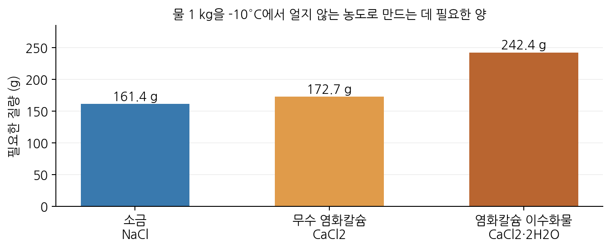

# 소금과 염화칼슘의 결빙 방지 효과와 비용 비교

용액의 농도와 어는점 내림을 활용한 프로그램 탐구

탐구 방법: 문헌 자료를 이용한 계산 | 작성일: 2026-10-21

## 1. 탐구 동기와 질문

염화칼슘은 제설제로 많이 사용된다. 그렇다면 같은 온도에서 물이 얼지 않게 할 때, 소금보다 항상 적은 양이 필요하고 비용도 적게 들까? 이 질문에 답하기 위해 필요한 양과 비용을 Python 프로그램으로 계산하였다.

비교 기준은 ‘처음에 있는 물 1 kg이 목표 온도에서 얼기 시작하지 않는 농도에 도달하는 데 필요한 양’으로 정하였다. 비교 온도는 -5°C, -10°C, -15°C이다.

## 2. 교과 개념과 탐구 방법

소금과 염화칼슘은 물에 녹아 이온으로 나뉘고, 물의 어는 온도를 낮춘다. 이것이 어는점 내림이다. 다만 같은 질량을 넣었을 때 생기는 입자 수는 물질마다 다르므로, 이온으로 나뉘는 개수만 보고 효과를 판단하기는 어렵다.

자료집에 제시된 ‘농도에 따른 어는 온도’를 이용하였다. 불순물이 없는 염을 기준으로 ASHRAE 2017의 표 1·2를 사용하였으며, 표에 없는 중간값은 양쪽 값 사이를 직선으로 연결해 구했다. 프로그램은 필요한 농도를 찾고, 그 농도를 만드는 데 필요한 질량과 비용을 계산하였다.

    질량 퍼센트 농도(%) = 녹아 있는 염의 질량 / 용액 전체 질량 × 100

예를 들어 -10°C에서 필요한 소금 농도는 기본 자료에서 13.9%였다. 물 1,000 g에 넣을 소금을 x g이라 하면, x / (1,000 + x) × 100 = 13.9이므로 소금은 약 161.4 g 필요하다.

염화칼슘은 물이 포함되지 않은 ‘무수 염화칼슘’과, 결정 속에 물 분자가 들어 있는 ‘염화칼슘 이수화물(CaCl2·2H2O)’을 구분하였다. 이수화물은 질량의 약 75.5%가 CaCl2이고 나머지는 물이므로, 이 물도 용액의 물에 더해 계산하였다. 모든 시판 제품이 이수화물과 같은 조성이라고 가정하지는 않았다.

<!-- pagebreak -->

## 3. 프로그램으로 얻은 결과

처음에 있는 물 1 kg을 기준으로 계산한 필요량은 다음과 같다. 물이 얼기 시작하는 경계에서 구한 최소량이며, 실제 도로에 뿌릴 권장량을 뜻하지는 않는다.

| 온도 | 소금 NaCl | 무수 CaCl2 | CaCl2·2H2O |
|---|---:|---:|---:|
| -5°C | 87.0 g | 104.1 g | 142.7 g |
| -10°C | 161.4 g | 172.7 g | 242.4 g |
| -15°C | 230.8 g | 223.9 g | 319.8 g |

-10°C에서 소금은 161.4 g, 무수 염화칼슘은 172.7 g 필요했다. -15°C에서는 무수 염화칼슘의 필요량이 소금보다 조금 적었다. 따라서 어느 물질이 적게 필요한지는 온도에 따라 달라졌다.

이수화물은 -10°C에서 242.4 g이 필요했다. 같은 kg당 가격이라면 소금보다 비용이 약 1.50배 든다. 예를 들어 소금이 1 kg당 1,000원이라고 가정하면, 이수화물은 약 666원 이하일 때 같은 조건을 만드는 비용이 같거나 낮아진다. 여기의 1,000원은 비교를 위한 가정 가격이다.

자료집이 달라져도 같은 결론이 나오는지 확인하기 위해 제조사 자료로 다시 계산하였다. 이 경우 위 가격 기준은 약 787원으로 달라졌다. 정확한 값에는 차이가 있었지만, -10°C에서 두 제품의 kg당 가격이 같다면 소금 쪽 비용이 낮다는 결과는 유지되었다.

<!-- pagebreak -->

## 4. 결과 해석과 결론

이번 계산에서는 소금과 염화칼슘 중 어느 하나가 항상 더 적게 필요하지는 않았다. 제품에 물이 포함되어 있는지도 결과에 영향을 주었다. 제설제를 고를 때에는 목표 온도, 제품의 성분과 함량, kg당 가격을 함께 확인해야 한다.

환경과 관련해서는 투입되는 염화물의 양도 계산하였다. -10°C의 기본 자료에서는 무수 염화칼슘의 염화물 투입량이 소금보다 약 12.7% 많았지만, 제조사 자료로 계산하면 약 3.8% 적었다. 따라서 이 자료만으로 어느 쪽이 항상 환경에 더 좋다고 단정할 수는 없었다. 염화물 투입량만으로 실제 생태 피해나 부식 정도가 정해지는 것도 아니다.

본 탐구의 의의는 같은 목표를 달성하는 데 필요한 양을 기준으로 비용을 비교하고, 제품을 선택할 수 있는 가격 기준을 구했다는 데 있다. 프로그램을 이용해 여러 온도의 계산을 반복하고 자료를 바꾸어 결과를 확인할 수 있었다.

다만 이번 탐구는 어는 온도를 기준으로 한 계산이다. 얼음을 얼마나 빨리 녹이는지, 실제 도로에서 얼마나 뿌려야 하는지는 따로 확인해야 한다. 앞으로 실험을 추가한다면 같은 온도와 시간에서 녹은 얼음의 양을 측정해 비교할 수 있다.

## 5. 소스 코드와 계산 자료

사용한 프로그램의 소스 코드, 입력 자료, 계산 결과와 그래프는 GitHub에 정리하였다.

저장소: [https://github.com/gamparda/deicer-research](https://github.com/gamparda/deicer-research)

분석 코드: [analyze.py](https://github.com/gamparda/deicer-research/blob/main/analyze.py) · 입력 자료: [data 폴더](https://github.com/gamparda/deicer-research/tree/main/data)

저장소에서 소스 코드와 입력 자료, 계산 결과를 함께 확인할 수 있다. 실행 방법은 저장소의 README에 적었다. 코드 작성과 자료 정리에는 AI 도구를 활용하였다.

## 참고 자료

1. [ASHRAE(2017), Chapter 31, 표 1·2](https://handbook.ashrae.org/handbooks/F17/SI/f17_ch31/f17_ch31_si.aspx): 기본 농도–어는 온도 자료.
2. [ASHRAE(2025), Chapter 31, 표 2A](https://handbook.ashrae.org/Handbooks/F25/SI/f25_Ch31/f25_Ch31_si.aspx): 다시 계산할 때 사용한 소금 자료.
3. [OxyChem(2026), Calcium Chloride Handbook, 표 3a](https://www.oxychemcalciumchloride.com/siteassets/documents/guides/calcium-chloride-handbook.pdf): 다시 계산할 때 사용한 염화칼슘 자료.
